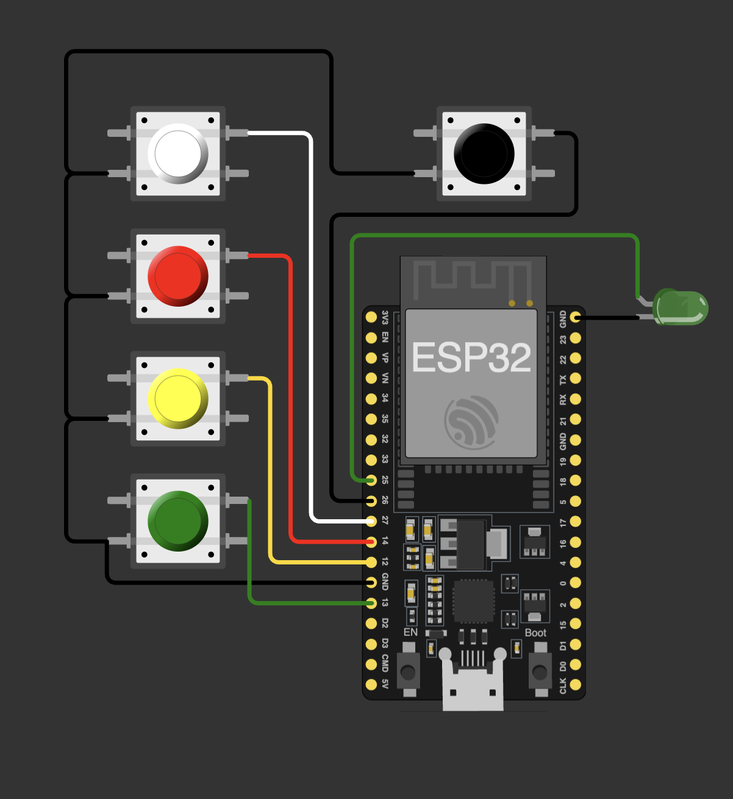

# Electronics

## Final pad — system explanation

**Signal chain.** Four momentary switches (happy / neutral / sad / question) connect GPIO 13 / 12 / 14 / 27 to GND. All inputs use the ESP32's internal pull-ups (`INPUT_PULLUP`) and read active-low, so the signal side needs no external resistors; contact bounce is handled in firmware (state-change detection + settle delay). The question button is a larger illuminated switch to invite use.

**Activation.** A lever limit switch on GPIO 26 sits under the phone slot. The station is logically idle until a phone is placed into the slot, which closes the switch, enables input processing, and lights the green status LED on GPIO 25 — "phone away" literally becomes the on-switch.

**Power.** A single 3.7 V LiPo cell feeds a LiPo Amigo Pro, which provides protected charging (USB-C), over-discharge protection, and clean handoff to the ESP32 dev board's regulator. The pad runs fully untethered; the side USB cutout allows flashing and charging without disassembly.

**Networking hardware.** No radio modules needed — the ESP32's built-in Wi-Fi carries the WebSocket link (the festival variant uses ESP-NOW between bare ESP32s instead, see `../Code/festival-judging/`).

## Prototype wiring

- [`tinkercad-v1.png`](tinkercad-v1.png) — V1.5 plan: single button set + student cycling on an Arduino R4
- [`tinkercad-v2.png`](tinkercad-v2.png) — V2.0 plan: three 4-button stations across 12 GPIOs

Every stage was planned in TinkerCad before touching hardware; build photos are in `../Images/`.
