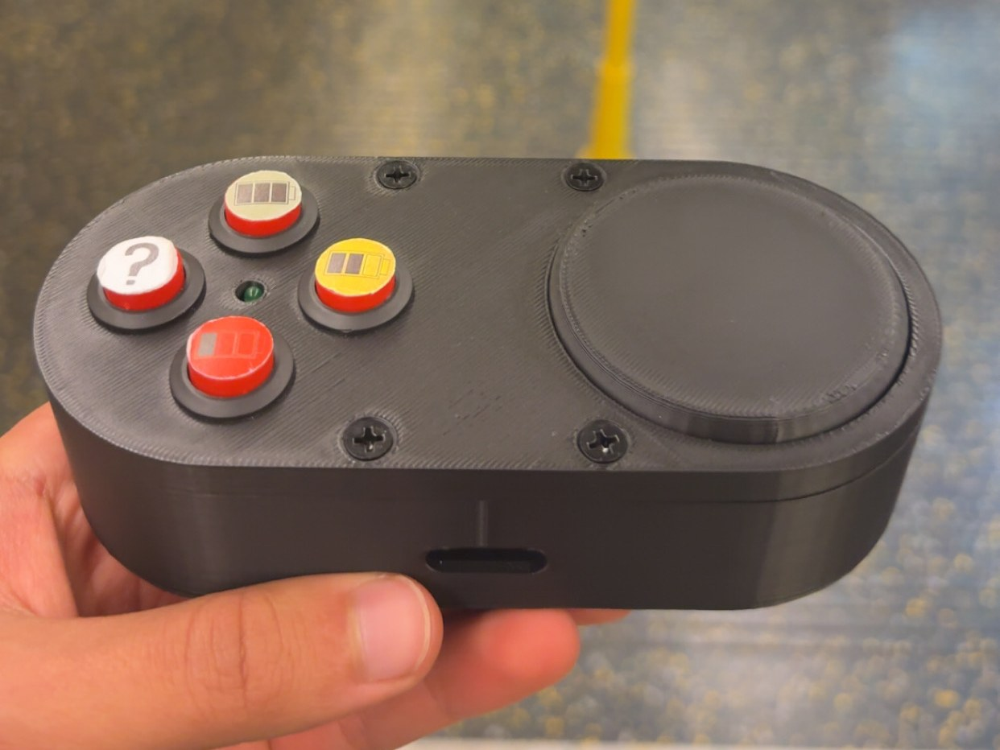

# Lecture Pulse

A real-time lecture feedback system: a physical reaction pad that lets students signal focus level and questions to the lecturer live, aggregated across the room into a rolling focus score and question alerts displayed on the lecturer's screen.

Developed by Team X-RAAY for the Human Centred Design module, Design Engineering MEng, Imperial College London (2025–26). **Grade: A · Selected to present at the Great Exhibition Road Festival.**



## Overview

Limited student–lecturer communication reduces engagement and leaves lecturers relying on subjective classroom cues. Lecture Pulse gives students a low-friction physical channel: press a focus-level button or the question button, and the room's aggregate state reaches the lecturer in real time — no phones, no apps to open, no cognitive overhead.

The system turns individual button presses into:

- a **rolling focus score** (−10 to +10) aggregated across all connected pads, mapped to an RGB colour scale on the lecturer's display
- an **anonymous question alert**, encouraging participation without putting students on the spot

## System Architecture

The network went through two architectures. The mid-project system used an **ESP-NOW mesh** bridged to the laptop over USB serial. The final system (this repo's code) is fully wireless: each pad is a **Wi-Fi WebSocket client** of a local Python bridge server, which maintains the room state and rebroadcasts it to the browser overlay.

```text
[Pad ESP32 #1] ──Wi-Fi WS──┐
                           ├──> [serial_bridge.py — WebSocket server :8765] ──WS──> [Chrome overlay (Tampermonkey)]
[Pad ESP32 #2] ──Wi-Fi WS──┘
```

Each pad sends JSON button events with its `STUDENT_ID`; the bridge averages votes into the room-level focus score and tracks question state. Pads auto-reconnect if the link drops mid-lecture.

## Hardware

The physical pad (my primary contribution — design and build):

- **ESP32** microcontroller per pad
- **Illuminated push buttons** — GPIO 13 (happy) / 12 (neutral) / 14 (sad) / 27 (question), all `INPUT_PULLUP`
- **Phone-slot activation switch** — limit switch on GPIO 26; placing a phone into the slot powers the station (green status LED on GPIO 25), turning "put your phone away" into the on-switch
- **LiPo power**: 3.7 V LiPo cell with a LiPo Amigo Pro for charging/protection, so the pad runs untethered
- **USB access port** for programming and charging the ESP32 without disassembly

Wiring diagrams in [`Electronics/`](Electronics/): [final pad circuitry](Electronics/final-pad-circuitry.png), plus the TinkerCad breadboard plans for prototype stages [v1](Electronics/tinkercad-v1.png) and [v2](Electronics/tinkercad-v2.png).

## Enclosure & Mechanical Design

The enclosure went through several physical iterations (see `Docs/Delivery-Report.pdf`, pp. 5–6):

- Early concepts: slider-based input (rejected — potentiometer cost + complexity), desk-edge clip and snap-band mounts (user-tested, rejected on security/portability)
- Chosen form: **game-controller-inspired compact cuboid** — user testing showed the familiar, leisure-associated form increased willingness to engage
- Final enclosure: significantly smaller than earlier iterations, with button openings on the top face, integrated phone slot, **heat-set threaded inserts** and countersunk screws for a strong, seamless assembly, and component mounting features for serviceable electronics

Full CAD in [`CAD/`](CAD/): the complete assembly as STEP, print-ready STLs for all three printed parts, and renders of the design evolution — [v1 box](CAD/CADimage-casing-v1.jpg) → [v2 compact form](CAD/CADimage-casing-v2.png) → [final base shell](CAD/CADimage-base-shell.png).

## Prototyping History

Four functional stages, all preserved in [`Code/prototypes/`](Code/prototypes/):

1. **First button tests** — Arduino R4, six buttons, raw serial output; proof of wiring
2. **Student-cycle prototype** — one button set + prev/next cycling between four virtual students; introduced the scoring engine: per-student vote store, exponentially smoothed score (α = 0.05), question threshold (2 presses within 10 s), LED-matrix face output and the `SCORE:`/`QUESTION:` serial protocol
3. **Separate-stations prototype** — three fixed 4-button stations on one board (12 GPIO); real simultaneous multi-student input feeding the same engine and an HTML slideshow display via the serial bridge
4. **Final ESP32 pads** — per-student wireless stations in the production casing, battery-powered, phone-slot switched

Each stage's wiring was planned in TinkerCad before building — see `Electronics/` and the breadboard photos in `Images/`.

## Software

All in [`Code/`](Code/):

- [`Code/pad-firmware/ESP32_StudentStation.ino`](Code/pad-firmware/ESP32_StudentStation.ino) — pad firmware: debounced button reads, JSON events over Wi-Fi WebSockets, auto-reconnect, phone-slot activation
- [`Code/bridge/serial_bridge.py`](Code/bridge/serial_bridge.py) — Python bridge: auto-detects USB serial hardware, holds room state `{score, question}`, WebSocket server for the overlay
- [`Code/overlay/classroom-mood-bar.user.js`](Code/overlay/classroom-mood-bar.user.js) — Tampermonkey overlay: live mood bar mapping the −10…+10 focus score to an RGB scale over the lecture slides, plus the question indicator

## Great Exhibition Road Festival

Lecture Pulse was selected for public showcase at Imperial's Great Exhibition Road Festival. For the stand I built a dedicated **ESP-NOW judging system** ([`Code/festival-judging/`](Code/festival-judging/)): two wireless judge pads and a master relay ESP32 that aggregates votes and feeds the live display over serial — no on-site Wi-Fi needed. Festival photos are in [`Images/festival/`](Images/festival/).

## User Testing

Key design decisions were validated with structured user testing (details in `Docs/Delivery-Report.pdf`): battery-style focus icons won A/B testing as the clearest scale metaphor, the rounded question button was preferred for approachability, and 20 of 21 participants chose silky matte silicone button finish over polished PLA.

## Documents

- [`Docs/Discovery-Report.pdf`](Docs/Discovery-Report.pdf) — research, interviews, insight themes, concept generation and selection
- [`Docs/Delivery-Report.pdf`](Docs/Delivery-Report.pdf) — concept development, prototyping, electronics, software, user testing, final design

## Team

Team X-RAAY — Roma Krishna Moorthy, Yusra Ali, Aleisha, Amy, and Xavier Goff (physical pad design, core electronics, power system and phone-slot switch).

## Repository Structure

```text
.
├── README.md
├── CAD/          # STEP assembly, printable STLs, renders
├── Code/         # firmware, bridge, overlay, prototypes, festival judging system
├── Electronics/  # circuitry + TinkerCad wiring diagrams
├── Images/       # product, build and festival photos
└── Docs/         # discovery & delivery reports
```
